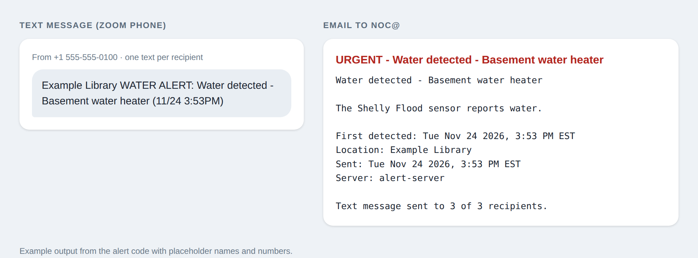

# senylrc-water-alarm

Leak alerting for a small building, on a single Ubuntu server. Shelly Flood Gen4 water sensors report over MQTT to a local Mosquitto broker. A Python service (`water_alert.py`) turns "water detected" into text messages sent from a Zoom Phone number, plus an email. Alerts repeat until the sensor is dry, then a "CLEARED" message goes out.



## Features

- **Local first.** Sensors talk to your own broker, so leak alerts don't depend on the Shelly cloud.
- **Texts and email.** Critical alerts go to every recipient as a separate text, then to email. A texting failure never blocks the email.
- **Watchdogs.** Email warnings for low batteries, a down broker, and a broken Zoom sign-in.
- **Optional Flume support** for whole-house flow monitoring (high flow, nonstop flow, quiet-hours use).
- **Encrypted sensor link (optional).** TLS on the MQTT listener with a private CA.
- Small codebase: one Python file, `requests` and `paho-mqtt`.

## Quick start

```bash
cd water-alert
sudo ./install.sh
```

Then follow [water-alert/README.md](water-alert/README.md) for email, Zoom texting, sensor setup and securing the MQTT connection.

## Security

Never commit `water-alert.ini`, `zoom_tokens.json`, MQTT credentials, or TLS keys; `.gitignore` covers them. Plain MQTT on port 1883 is unencrypted, so isolate the sensors on their own network or enable TLS. See "Securing the sensor connection" in the install guide.

## License

[MIT](LICENSE)
